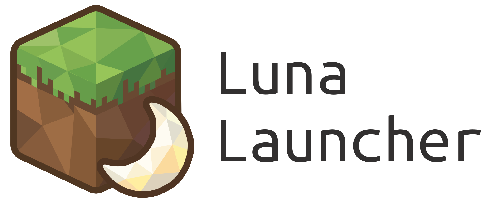

<p align="center">
<picture>
  <source media="(prefers-color-scheme: dark)" srcset="./program_info/cc.sirrus.LunaLauncher.logo-darkmode.svg">
  <source media="(prefers-color-scheme: light)" srcset="./program_info/cc.sirrus.LunaLauncher.logo.source.svg">
  
</picture>
</p>


<p align="center">
  <a href="README.md">English</a> | <a href="README.zh-CN.md">简体中文</a>
</p>

<p align="center">
  Luna Launcher is a custom launcher for Minecraft that allows you to manage multiple Minecraft installations with ease.<br />
  <br />
  Visit our website at <a href="https://lunalauncher.sirrus.cc">lunalauncher.sirrus.cc</a> for more information.<br />
  <br />
  Development builds are available on <a href="https://github.com/AndreaFrederica/LunaLauncher/actions">GitHub Actions</a>.<br />
  This project is an independent <b>fork</b> of Prism Launcher and is <b>not</b> endorsed by or affiliated with the Prism Launcher project.
  <br />
  It improves accessibility by supporting community-maintained mirror APIs such as <b>BMCLAPI</b>.
</p>

---

> **⚠️ Build System Change: Meson Now Required**
>
> Luna Launcher has switched from **CMake** to **Meson** as its primary build system. The `CMakeLists.txt` is retained for compatibility but is **no longer actively maintained** and may have issues.
>
> **If you are backporting features from Luna to Prism Launcher or another fork:** Please be aware that build-related changes in Luna are written for Meson (`meson.build`, `meson_options.txt`, `scripts/pixi_meson.py`). You will need to adapt them to CMake if your target still uses CMake.
>
> See the [Build Guide](https://lunalauncher.sirrus.cc/build.html) for updated instructions.

---

## Features

> **Note:** Luna is an enhanced fork of Prism Launcher, adding extra features on top of Prism's foundation while maintaining full compatibility with Prism Launcher instances and functionality.
>
> We welcome developers to backport Luna's features to the upstream Prism Launcher. Luna does not actively submit PRs due to limited developer time—all Luna maintainers are hobbyist developers who also maintain other open source projects. If you're interested in contributing, please reach out to us!

- **Server Management (In Development)**: Manage Minecraft server instances directly from the launcher, including downloading, configuring, and managing server JARs
- **P2P Multiplayer**: Built-in support for [Terracotta](https://github.com/burningtnt/Terracotta) and [YukariConnect](https://github.com/ElicaseTech/YukariConnect) - play with friends without port forwarding or complex network setup (YukariConnect is intended as an alternative to the AGPL-licensed Terracotta and can be provided as a standalone component)
- **Mirror API Support**
- **Fluent Themes**: Built-in Fluent Dark/Light themes and icon resources
- **New UI Layout**: Optional experimental 3-column layout (requires restart)
- **Server Preview**: Quick server preview access from the toolbar
- **Custom Models**: Support custom player models including the Yes Steve model
- **Schematic Files**: Resource management support for Minecraft schematic files
- **Cross-platform**: Available for Windows, Linux, and macOS
- **NeoUI Formwork**: Use any web tool to build your UI

---

## LunaUI Custom Panel Scripting

Luna Launcher supports per-instance custom setting panels under `lunaui`.

- Runtime folder: `<instance-root>/lunaui`
- Development docs: [`docs/lunaui/README.md`](docs/lunaui/README.md)
- Type definitions (`.d.ts`): [`docs/lunaui/lunaui.d.ts`](docs/lunaui/lunaui.d.ts)

The `.d.ts` file is intended for editor IntelliSense when writing `lunaui/*.js` scripts.

---

## Installation

Installation instructions and downloads will be provided once stable releases are available.

At the moment, this project is primarily intended for developers and early testers.

---

## Building

This project uses **Meson** as its build system. The recommended way to build is via **Pixi**, which handles dependencies and environment setup automatically.

### Quick Start (Pixi)

#### Prerequisites

- [Pixi](https://pixi.sh/latest/installation/)

**Windows:** You must run commands from the **x64 Native Tools Command Prompt for VS 2022** (or corresponding VS version).

**Linux:** Ensure `gcc`, `g++`, `pkg-config`, and Qt 6 development libraries are available (Pixi will install most of them).

```bash
# 1. Configure
pixi run configure

# 2. Build
pixi run build

# 3. Install
pixi run install
```

#### Available Tasks

| Command | Description |
|---------|-------------|
| `pixi run configure` | Configure Meson build directory |
| `pixi run build` | One-shot setup + compile with Meson |
| `pixi run install` | Build and install with Meson |
| `pixi run deploy` | Run `windeployqt` and copy runtime DLLs (Windows only) |
| `pixi run install_qt` | Download/install Qt into `third_party/qt` |
| `pixi run install-webui` | Configure, compile, install and deploy launcher + optional Neo Web UI |
| `pixi run run-webui` | Run the installed Neo UI |
| `pixi run webui-assets` | Type-check and export a standalone Web UI bundle |
| `pixi run webui-dev` | Start frontend browser preview |

For the complete Web UI workflow, bridge API, external bundles, and lifecycle
contract, see [Web UI development](docs/WEBUI-DEVELOPMENT.md) (Chinese).
`install-webui` defaults to `install-webui-release`; the standard `install` task
keeps Neo UI disabled. Both workflows use Pixi's pnpm/Rust and Meson.

#### Build Profiles

| Profile | Description |
|---------|-------------|
| `release` (default) | Release build with static libraries |
| `debug` | Debug build with shared libraries |
| `linux-x64-gcc-release` | Linux cross-compile release build |

```bash
# Build in debug mode
pixi run build debug

# Build for Linux (cross-compile from Windows)
pixi run build linux-x64-gcc-release
```

### Linux Native Build

On a Linux machine, you can also use Pixi directly:

```bash
# Install dependencies (Arch example)
sudo pacman -S meson ninja gcc pkgconf qt6-base qt6-svg qt6-imageformats qt6-5compat quazip-qt6 cmark

# Configure
pixi run configure

# Build
pixi run build

# Install
pixi run install
```

### Manual Meson Build

If you prefer not to use Pixi:

```bash
# Install dependencies (Ubuntu/Debian example)
sudo apt install meson ninja-build gcc g++ pkg-config qt6-base-dev qt6-svg-dev qt6-imageformats-dev qt6-5compat-dev libquazip1-qt6-dev libcmark-dev zlib1g-dev libarchive-dev liblz4-dev libzstd-dev liblzma-dev libbz2-dev libqrencode-dev

# Configure
meson setup build --buildtype=release --wrap-mode=forcefallback

# Build
meson compile -C build

# Install
meson install -C build --no-rebuild
```

#### Useful Meson Options

| Option | Description | Default |
|--------|-------------| ------- |
| `-Dbuild_testing` | Disable tests (default) | `false` |
| `-Dbuild_updater` | Disable auto-updater | `false` |
| `-Denable_java_downloader` | Enable Java auto-downloader | `true` |
| `-Ddeveloper_mode_build` | Enable developer mode | `false` |
| `-Dgamemode` | Enable GameMode support (Linux) | `enabled` |
| `-Db_vscrt` | Use MSVC dynamic runtime (Windows) | `md` |

---

## Detailed Build Instructions

### Getting the Source

Clone the source code using git, and grab all the submodules:

```bash
git clone --recursive https://github.com/AndreaFrederica/LunaLauncher.git
cd LunaLauncher
```

The rest of the documentation assumes you have already cloned the repository.

### IDE Setup

#### VS Code

1. Install the [Meson extension](https://marketplace.visualstudio.com/items?itemName=mesonbuild.mesonbuild) for Meson support
2. Install the [C/C++ extension](https://marketplace.visualstudio.com/items?itemName=ms-vscode.cpptools)
3. Open the project folder - VS Code should auto-detect the Meson build
4. Build tasks are available via `Ctrl+Shift+B`

#### CLion

1. Open CLion → File → Open → Select source folder
2. CLion will automatically detect the Meson project
3. Settings → Build → Meson → Set build directory if needed
4. Build and Run with the buttons

#### Qt Creator

1. Install Qt Creator
2. File → Open File or Project → Select the project root (Qt Creator detects `meson.build`)
3. Configure the project when prompted
4. Press the "Run" button

---

## Acknowledgements

Luna Launcher would not be possible without the work of earlier projects and their contributors.

- **Prism Launcher** — for maintaining a modern, open, and community-driven Minecraft launcher.
- **MultiMC** — the original project that laid the foundation for many third-party Minecraft launchers.

We sincerely thank all contributors to these projects for their long-standing efforts in the Minecraft community.

---

## Forking / Redistribution Policy

You are free to fork, redistribute, and provide custom builds as long as you follow the terms of the [license](LICENSE).

If you make code changes (rather than only packaging):

- Make it clear that your fork is **not** Prism Launcher and is **not** endorsed by or affiliated with the Prism Launcher project.
- Go through `meson.build` and change any upstream API keys to your own, or set them to empty strings (`""`) to disable the related functionality.
- For packaged system builds, set `--prefix=/usr`. Avoid `/usr/local` for distro-managed packages.

For Fedora/COPR packaging, see [packaging/fedora/README.md](packaging/fedora/README.md).

---

<!-- contributors:start -->
## Contributors

Built by the Luna community, on the foundations of Prism Launcher and MultiMC. Thank you to everyone who has contributed.

<table width="100%">
<tbody>
<tr>
<td>
<h3>Luna contributors</h3>
<p>The people building and improving Luna Launcher.</p>
<p><a href="https://github.com/AndreaFrederica" title="AndreaFrederica"></a>
<a href="https://github.com/AuraElicase" title="AuraElicase"></a>
<a href="https://github.com/kasuganomeow" title="kasuganomeow"></a>
<a href="https://github.com/W-874" title="W-874"></a></p>
</td>
</tr>
</tbody>
</table>

<table width="100%">
<tbody>
<tr>
<td>
<h3>Co-contributors</h3>
<p>Contributors to both Luna Launcher and Prism Launcher.</p>
<p><a href="https://github.com/Octol1ttle" title="Octol1ttle"></a>
<a href="https://github.com/Trial97" title="Trial97"></a></p>
</td>
</tr>
</tbody>
</table>

<table width="100%">
<tbody>
<tr>
<td>
<h3>Upstream contributors</h3>
<p>Thank you to the Prism Launcher community, whose work Luna builds on.</p>
<p><a href="https://github.com/02JanDal" title="02JanDal"></a>
<a href="https://github.com/0osh" title="0osh"></a>
<a href="https://github.com/0x189D7997" title="0x189D7997"></a>
<a href="https://github.com/0xhanlie" title="0xhanlie"></a>
<a href="https://github.com/2lay" title="2lay"></a>
<a href="https://github.com/44trent3" title="44trent3"></a>
<a href="https://github.com/9p4" title="9p4"></a>
<a href="https://github.com/A-UNDERSCORE-D" title="A-UNDERSCORE-D"></a>
<a href="https://github.com/abhicommands" title="abhicommands"></a>
<a href="https://github.com/AbigailBuccaneer" title="AbigailBuccaneer"></a>
<a href="https://github.com/acdpsn" title="acdpsn"></a>
<a href="https://github.com/ACGaming" title="ACGaming"></a>
<a href="https://github.com/AffeAli" title="AffeAli"></a>
<a href="https://github.com/AhmedAliElashmawy" title="AhmedAliElashmawy"></a>
<a href="https://github.com/ajerick" title="ajerick"></a>
<a href="https://github.com/alcremieow" title="alcremieow"></a>
<a href="https://github.com/AlexTMjugador" title="AlexTMjugador"></a>
<a href="https://github.com/AliceDTRH" title="AliceDTRH"></a>
<a href="https://github.com/Anceph" title="Anceph"></a>
<a href="https://github.com/andersmmg" title="andersmmg"></a>
<a href="https://github.com/andrey545454" title="andrey545454"></a>
<a href="https://github.com/apix0n" title="apix0n"></a>
<a href="https://github.com/arch1t3cht" title="arch1t3cht"></a>
<a href="https://github.com/archessmn" title="archessmn"></a>
<a href="https://github.com/Arcitec" title="Arcitec"></a>
<a href="https://github.com/arnfaldur" title="arnfaldur"></a>
<a href="https://github.com/AshleighTheCutie" title="AshleighTheCutie"></a>
<a href="https://github.com/AshtakaOOf" title="AshtakaOOf"></a>
<a href="https://github.com/ashuntu" title="ashuntu"></a>
<a href="https://github.com/asiekierka" title="asiekierka"></a>
<a href="https://github.com/AtomHare" title="AtomHare"></a>
<a href="https://github.com/Awqre" title="Awqre"></a>
<a href="https://github.com/Azenet" title="Azenet"></a>
<a href="https://github.com/babbaj" title="babbaj"></a>
<a href="https://github.com/BalkanMadman" title="BalkanMadman"></a>
<a href="https://github.com/bensuperpc" title="bensuperpc"></a>
<a href="https://github.com/benthetechguy" title="benthetechguy"></a>
<a href="https://github.com/bexnoss" title="bexnoss"></a>
<a href="https://github.com/Bildcraft1" title="Bildcraft1"></a>
<a href="https://github.com/bit69tream" title="bit69tream"></a>
<a href="https://github.com/bolli24" title="bolli24"></a>
<a href="https://github.com/brainiac744" title="brainiac744"></a>
<a href="https://github.com/Bryntet" title="Bryntet"></a>
<a href="https://github.com/budak7273" title="budak7273"></a>
<a href="https://github.com/bunchy7s" title="bunchy7s"></a>
<a href="https://github.com/byquanton" title="byquanton"></a>
<a href="https://github.com/byteduck" title="byteduck"></a>
<a href="https://github.com/c8dhjp4tyv-bit" title="c8dhjp4tyv-bit"></a>
<a href="https://github.com/Cartrigger" title="Cartrigger"></a>
<a href="https://github.com/catfromplan9" title="catfromplan9"></a>
<a href="https://github.com/ch4og" title="ch4og"></a>
<a href="https://github.com/chmodsayshello" title="chmodsayshello"></a>
<a href="https://github.com/chouzz" title="chouzz"></a>
<a href="https://github.com/chrhasse" title="chrhasse"></a>
<a href="https://github.com/ChrisLane" title="ChrisLane"></a>
<a href="https://github.com/Chrono-byte" title="Chrono-byte"></a>
<a href="https://github.com/cidkidnix" title="cidkidnix"></a>
<a href="https://github.com/clague" title="clague"></a>
<a href="https://github.com/clickdevin" title="clickdevin"></a>
<a href="https://github.com/CodingMarco" title="CodingMarco"></a>
<a href="https://github.com/colbiedison" title="colbiedison"></a>
<a href="https://github.com/ColonelGerdauf" title="ColonelGerdauf"></a>
<a href="https://github.com/comp500" title="comp500"></a>
<a href="https://github.com/cpreh" title="cpreh"></a>
<a href="https://github.com/CreeperzEdge" title="CreeperzEdge"></a>
<a href="https://github.com/crpz1" title="crpz1"></a>
<a href="https://github.com/crueter" title="crueter"></a>
<a href="https://github.com/crueter-archive" title="crueter-archive"></a>
<a href="https://github.com/cthbleachbit" title="cthbleachbit"></a>
<a href="https://github.com/cullvox" title="cullvox"></a>
<a href="https://github.com/cyyynthia" title="cyyynthia"></a>
<a href="https://github.com/D00NIK" title="D00NIK"></a>
<a href="https://github.com/Dan4oby" title="Dan4oby"></a>
<a href="https://github.com/danielhuang" title="danielhuang"></a>
<a href="https://github.com/dannydjdk" title="dannydjdk"></a>
<a href="https://github.com/DavidoTek" title="DavidoTek"></a>
<a href="https://github.com/davispuh" title="davispuh"></a>
<a href="https://github.com/dblsaiko" title="dblsaiko"></a>
<a href="https://github.com/deadmeu" title="deadmeu"></a>
<a href="https://github.com/deiseil" title="deiseil"></a>
<a href="https://github.com/Desoroxxx" title="Desoroxxx"></a>
<a href="https://github.com/desvaters" title="desvaters"></a>
<a href="https://github.com/DioEgizio" title="DioEgizio"></a>
<a href="https://github.com/dkaluta" title="dkaluta"></a>
<a href="https://github.com/dkarvik" title="dkarvik"></a>
<a href="https://github.com/Dnyanu76" title="Dnyanu76"></a>
<a href="https://github.com/dotniphi" title="dotniphi"></a>
<a href="https://github.com/dqfan2012" title="dqfan2012"></a>
<a href="https://github.com/dsch7705" title="dsch7705"></a>
<a href="https://github.com/dschemp" title="dschemp"></a>
<a href="https://github.com/dylanrenwick" title="dylanrenwick"></a>
<a href="https://github.com/edgarogh" title="edgarogh"></a>
<a href="https://github.com/edgars-cirulis" title="edgars-cirulis"></a>
<a href="https://github.com/eff3ry" title="eff3ry"></a>
<a href="https://github.com/EliteTK" title="EliteTK"></a>
<a href="https://github.com/embeddedt" title="embeddedt"></a>
<a href="https://github.com/enncoded" title="enncoded"></a>
<a href="https://github.com/Eonfge" title="Eonfge"></a>
<a href="https://github.com/erikLundstedt" title="erikLundstedt"></a>
<a href="https://github.com/evan-goode" title="evan-goode"></a>
<a href="https://github.com/exaskye" title="exaskye"></a>
<a href="https://github.com/f-schnabel" title="f-schnabel"></a>
<a href="https://github.com/flcmc" title="flcmc"></a>
<a href="https://github.com/flowln" title="flowln"></a>
<a href="https://github.com/fn2006" title="fn2006"></a>
<a href="https://github.com/forkiesassds" title="forkiesassds"></a>
<a href="https://github.com/Forkk" title="Forkk"></a>
<a href="https://github.com/Fourmisain" title="Fourmisain"></a>
<a href="https://github.com/frapank" title="frapank"></a>
<a href="https://github.com/frigtear" title="frigtear"></a>
<a href="https://github.com/FyberOptic" title="FyberOptic"></a>
<a href="https://github.com/Gaming32" title="Gaming32"></a>
<a href="https://github.com/getchoo" title="getchoo"></a>
<a href="https://github.com/Ghalid" title="Ghalid"></a>
<a href="https://github.com/ghosty141" title="ghosty141"></a>
<a href="https://github.com/Gideon9212" title="Gideon9212"></a>
<a href="https://github.com/Gingeh" title="Gingeh"></a>
<a href="https://github.com/glowiak" title="glowiak"></a>
<a href="https://github.com/graemeg" title="graemeg"></a>
<a href="https://github.com/Greenphlem" title="Greenphlem"></a>
<a href="https://github.com/GriffintheFolf" title="GriffintheFolf"></a>
<a href="https://github.com/guihkx" title="guihkx"></a>
<a href="https://github.com/GUIpsp" title="GUIpsp"></a>
<a href="https://github.com/gytis-ivaskevicius" title="gytis-ivaskevicius"></a>
<a href="https://github.com/hamarb123" title="hamarb123"></a>
<a href="https://github.com/HarryPeach" title="HarryPeach"></a>
<a href="https://github.com/haykam821" title="haykam821"></a>
<a href="https://github.com/he3als" title="he3als"></a>
<a href="https://github.com/Heath123" title="Heath123"></a>
<a href="https://github.com/heftymouse" title="heftymouse"></a>
<a href="https://github.com/helpimnotdrowning" title="helpimnotdrowning"></a>
<a href="https://github.com/henriquekirchheck" title="henriquekirchheck"></a>
<a href="https://github.com/Heufneutje" title="Heufneutje"></a>
<a href="https://github.com/hibiii" title="hibiii"></a>
<a href="https://github.com/hideki2k02" title="hideki2k02"></a>
<a href="https://github.com/Hubcapp" title="Hubcapp"></a>
<a href="https://github.com/hyperfang8" title="hyperfang8"></a>
<a href="https://github.com/iambob314" title="iambob314"></a>
<a href="https://github.com/iarspider" title="iarspider"></a>
<a href="https://github.com/IceCryptonym" title="IceCryptonym"></a>
<a href="https://github.com/icelimetea" title="icelimetea"></a>
<a href="https://github.com/IDeletedSystem64" title="IDeletedSystem64"></a>
<a href="https://github.com/iGerman00" title="iGerman00"></a>
<a href="https://github.com/ImperatorStorm" title="ImperatorStorm"></a>
<a href="https://github.com/Irgendwer01" title="Irgendwer01"></a>
<a href="https://github.com/iris-israd" title="iris-israd"></a>
<a href="https://github.com/isoraqathedh" title="isoraqathedh"></a>
<a href="https://github.com/ISSOtm" title="ISSOtm"></a>
<a href="https://github.com/istudyatuni" title="istudyatuni"></a>
<a href="https://github.com/isXander" title="isXander"></a>
<a href="https://github.com/IThundxr" title="IThundxr"></a>
<a href="https://github.com/iTrooz" title="iTrooz"></a>
<a href="https://github.com/ivanpu" title="ivanpu"></a>
<a href="https://github.com/Izder456" title="Izder456"></a>
<a href="https://github.com/jamierocks" title="jamierocks"></a>
<a href="https://github.com/Jan200101" title="Jan200101"></a>
<a href="https://github.com/Janrupf" title="Janrupf"></a>
<a href="https://github.com/jitterdev" title="jitterdev"></a>
<a href="https://github.com/JJL772" title="JJL772"></a>
<a href="https://github.com/jn64" title="jn64"></a>
<a href="https://github.com/JoelTroch" title="JoelTroch"></a>
<a href="https://github.com/johnnyapol" title="johnnyapol"></a>
<a href="https://github.com/jopejoe1" title="jopejoe1"></a>
<a href="https://github.com/joshua-stone" title="joshua-stone"></a>
<a href="https://github.com/jzhou-dev" title="jzhou-dev"></a>
<a href="https://github.com/Kationor" title="Kationor"></a>
<a href="https://github.com/kattschan" title="kattschan"></a>
<a href="https://github.com/kb-1000" title="kb-1000"></a>
<a href="https://github.com/kerichdev" title="kerichdev"></a>
<a href="https://github.com/KernelFreeze" title="KernelFreeze"></a>
<a href="https://github.com/khenriks" title="khenriks"></a>
<a href="https://github.com/Khitiara" title="Khitiara"></a>
<a href="https://github.com/Kilobyte22" title="Kilobyte22"></a>
<a href="https://github.com/Kim2091" title="Kim2091"></a>
<a href="https://github.com/kimrthn" title="kimrthn"></a>
<a href="https://github.com/kloenk" title="kloenk"></a>
<a href="https://github.com/KosmX" title="KosmX"></a>
<a href="https://github.com/Kranzes" title="Kranzes"></a>
<a href="https://github.com/kthchew" title="kthchew"></a>
<a href="https://github.com/ktheticdev" title="ktheticdev"></a>
<a href="https://github.com/kumquat-ir" title="kumquat-ir"></a>
<a href="https://github.com/Kurumi78" title="Kurumi78"></a>
<a href="https://github.com/kvverti" title="kvverti"></a>
<a href="https://github.com/lack" title="lack"></a>
<a href="https://github.com/LAHarbottle" title="LAHarbottle"></a>
<a href="https://github.com/LaoshuBaby" title="LaoshuBaby"></a>
<a href="https://github.com/leia-uwu" title="leia-uwu"></a>
<a href="https://github.com/Leo40Git" title="Leo40Git"></a>
<a href="https://github.com/leozamboni" title="leozamboni"></a>
<a href="https://github.com/leumasme" title="leumasme"></a>
<a href="https://github.com/lifehome" title="lifehome"></a>
<a href="https://github.com/lineargraph" title="lineargraph"></a>
<a href="https://github.com/localspook" title="localspook"></a>
<a href="https://github.com/lopcode" title="lopcode"></a>
<a href="https://github.com/LostLuma" title="LostLuma"></a>
<a href="https://github.com/loyal-thunder" title="loyal-thunder"></a>
<a href="https://github.com/ludgie" title="ludgie"></a>
<a href="https://github.com/Luk-ESC" title="Luk-ESC"></a>
<a href="https://github.com/lumiscosity" title="lumiscosity"></a>
<a href="https://github.com/lunaynx" title="lunaynx"></a>
<a href="https://github.com/makuraslvt" title="makuraslvt"></a>
<a href="https://github.com/MandipJoshi" title="MandipJoshi"></a>
<a href="https://github.com/marcelohdez" title="marcelohdez"></a>
<a href="https://github.com/maskersss" title="maskersss"></a>
<a href="https://github.com/MatejKafka" title="MatejKafka"></a>
<a href="https://github.com/MatthewCash" title="MatthewCash"></a>
<a href="https://github.com/matthewperiut" title="matthewperiut"></a>
<a href="https://github.com/maxnordlund" title="maxnordlund"></a>
<a href="https://github.com/MC42" title="MC42"></a>
<a href="https://github.com/mdeneen" title="mdeneen"></a>
<a href="https://github.com/MenacingPerson" title="MenacingPerson"></a>
<a href="https://github.com/metehanCekci" title="metehanCekci"></a>
<a href="https://github.com/michaeltyson" title="michaeltyson"></a>
<a href="https://github.com/Mick235711" title="Mick235711"></a>
<a href="https://github.com/MinecraftZuriki" title="MinecraftZuriki"></a>
<a href="https://github.com/Minion3665" title="Minion3665"></a>
<a href="https://github.com/MMK21Hub" title="MMK21Hub"></a>
<a href="https://github.com/moehreag" title="moehreag"></a>
<a href="https://github.com/Moresteck" title="Moresteck"></a>
<a href="https://github.com/morsznetik" title="morsznetik"></a>
<a href="https://github.com/mrmelon54" title="mrmelon54"></a>
<a href="https://github.com/MSameer0" title="MSameer0"></a>
<a href="https://github.com/muscaln" title="muscaln"></a>
<a href="https://github.com/mustafa-archived" title="mustafa-archived"></a>
<a href="https://github.com/NandoBF" title="NandoBF"></a>
<a href="https://github.com/natrow" title="natrow"></a>
<a href="https://github.com/ncete" title="ncete"></a>
<a href="https://github.com/Neptune650" title="Neptune650"></a>
<a href="https://github.com/NewoIsTaken" title="NewoIsTaken"></a>
<a href="https://github.com/nicyoong" title="nicyoong"></a>
<a href="https://github.com/NotAnonymous33" title="NotAnonymous33"></a>
<a href="https://github.com/NotNite" title="NotNite"></a>
<a href="https://github.com/notrudyyy" title="notrudyyy"></a>
<a href="https://github.com/Oreoezi" title="Oreoezi"></a>
<a href="https://github.com/OriginCode" title="OriginCode"></a>
<a href="https://github.com/Orochimarufan" title="Orochimarufan"></a>
<a href="https://github.com/overmighty" title="overmighty"></a>
<a href="https://github.com/oynqr" title="oynqr"></a>
<a href="https://github.com/Ozynt" title="Ozynt"></a>
<a href="https://github.com/p-schneider" title="p-schneider"></a>
<a href="https://github.com/p2js" title="p2js"></a>
<a href="https://github.com/Pagwin2" title="Pagwin2"></a>
<a href="https://github.com/pandaninjas" title="pandaninjas"></a>
<a href="https://github.com/parona-source" title="parona-source"></a>
<a href="https://github.com/pddshk" title="pddshk"></a>
<a href="https://github.com/PeakKS" title="PeakKS"></a>
<a href="https://github.com/peterix" title="peterix"></a>
<a href="https://github.com/phit" title="phit"></a>
<a href="https://github.com/piperswe" title="piperswe"></a>
<a href="https://github.com/pog5" title="pog5"></a>
<a href="https://github.com/pointydev" title="pointydev"></a>
<a href="https://github.com/porterporter" title="porterporter"></a>
<a href="https://github.com/Protrikk" title="Protrikk"></a>
<a href="https://github.com/Puqns67" title="Puqns67"></a>
<a href="https://github.com/qaptivator" title="qaptivator"></a>
<a href="https://github.com/RaptaG" title="RaptaG"></a>
<a href="https://github.com/razzeee" title="razzeee"></a>
<a href="https://github.com/rbutoi" title="rbutoi"></a>
<a href="https://github.com/RedsonBr140" title="RedsonBr140"></a>
<a href="https://github.com/redstrate" title="redstrate"></a>
<a href="https://github.com/Regular-Baf" title="Regular-Baf"></a>
<a href="https://github.com/renner0e" title="renner0e"></a>
<a href="https://github.com/rfl890" title="rfl890"></a>
<a href="https://github.com/rileyrichard" title="rileyrichard"></a>
<a href="https://github.com/Ristovski" title="Ristovski"></a>
<a href="https://github.com/rrrogalski" title="rrrogalski"></a>
<a href="https://github.com/RuinTD" title="RuinTD"></a>
<a href="https://github.com/runlevel5" title="runlevel5"></a>
<a href="https://github.com/ryanccn" title="ryanccn"></a>
<a href="https://github.com/Ryex" title="Ryex"></a>
<a href="https://github.com/SabrePenguin" title="SabrePenguin"></a>
<a href="https://github.com/SandaruKasa" title="SandaruKasa"></a>
<a href="https://github.com/santiagocezar" title="santiagocezar"></a>
<a href="https://github.com/Scotsguy" title="Scotsguy"></a>
<a href="https://github.com/Scrumplex" title="Scrumplex"></a>
<a href="https://github.com/Sebbl0508" title="Sebbl0508"></a>
<a href="https://github.com/ShadowPaint-SP" title="ShadowPaint-SP"></a>
<a href="https://github.com/sheldoncork" title="sheldoncork"></a>
<a href="https://github.com/sinidiem" title="sinidiem"></a>
<a href="https://github.com/Skyblueborb" title="Skyblueborb"></a>
<a href="https://github.com/sneedcat" title="sneedcat"></a>
<a href="https://github.com/snowlinouo" title="snowlinouo"></a>
<a href="https://github.com/so5iso4ka" title="so5iso4ka"></a>
<a href="https://github.com/SolidStateDj" title="SolidStateDj"></a>
<a href="https://github.com/solonovamax" title="solonovamax"></a>
<a href="https://github.com/SoniEx2" title="SoniEx2"></a>
<a href="https://github.com/Soup-64" title="Soup-64"></a>
<a href="https://github.com/srakitnican" title="srakitnican"></a>
<a href="https://github.com/srcres258" title="srcres258"></a>
<a href="https://github.com/sshcrack" title="sshcrack"></a>
<a href="https://github.com/SSUPII" title="SSUPII"></a>
<a href="https://github.com/StaticRocket" title="StaticRocket"></a>
<a href="https://github.com/SticksDev" title="SticksDev"></a>
<a href="https://github.com/stoltsvensk" title="stoltsvensk"></a>
<a href="https://github.com/StripedMonkey" title="StripedMonkey"></a>
<a href="https://github.com/Stypox" title="Stypox"></a>
<a href="https://github.com/sylveon" title="sylveon"></a>
<a href="https://github.com/Szowisz" title="Szowisz"></a>
<a href="https://github.com/taksuyu" title="taksuyu"></a>
<a href="https://github.com/TayouVR" title="TayouVR"></a>
<a href="https://github.com/Technous285" title="Technous285"></a>
<a href="https://github.com/telans" title="telans"></a>
<a href="https://github.com/TheCodex6824" title="TheCodex6824"></a>
<a href="https://github.com/TheComputerGuy96" title="TheComputerGuy96"></a>
<a href="https://github.com/TheCourierNV" title="TheCourierNV"></a>
<a href="https://github.com/TheDoctorsLife" title="TheDoctorsLife"></a>
<a href="https://github.com/TheEvilSkeleton" title="TheEvilSkeleton"></a>
<a href="https://github.com/TheFrenchGhosty" title="TheFrenchGhosty"></a>
<a href="https://github.com/TheGlitch76" title="TheGlitch76"></a>
<a href="https://github.com/TheKodeToad" title="TheKodeToad"></a>
<a href="https://github.com/TheLastRar" title="TheLastRar"></a>
<a href="https://github.com/theMackabu" title="theMackabu"></a>
<a href="https://github.com/TheOPtimal" title="TheOPtimal"></a>
<a href="https://github.com/thonkdifferent" title="thonkdifferent"></a>
<a href="https://github.com/tildejustin" title="tildejustin"></a>
<a href="https://github.com/timoreo22" title="timoreo22"></a>
<a href="https://github.com/tjw123hh" title="tjw123hh"></a>
<a href="https://github.com/Tkain" title="Tkain"></a>
<a href="https://github.com/tobfos2611" title="tobfos2611"></a>
<a href="https://github.com/tobimori" title="tobimori"></a>
<a href="https://github.com/TreyRuffy" title="TreyRuffy"></a>
<a href="https://github.com/tsmock" title="tsmock"></a>
<a href="https://github.com/TurboWafflz" title="TurboWafflz"></a>
<a href="https://github.com/turret-dev" title="turret-dev"></a>
<a href="https://github.com/txtsd" title="txtsd"></a>
<a href="https://github.com/Un1q32" title="Un1q32"></a>
<a href="https://github.com/unnameduser5000" title="unnameduser5000"></a>
<a href="https://github.com/UnownPlain" title="UnownPlain"></a>
<a href="https://github.com/vancez" title="vancez"></a>
<a href="https://github.com/Vaxry" title="Vaxry"></a>
<a href="https://github.com/vedantmgoyal9" title="vedantmgoyal9"></a>
<a href="https://github.com/ViRb3" title="ViRb3"></a>
<a href="https://github.com/virchau13" title="virchau13"></a>
<a href="https://github.com/Vishrut2403" title="Vishrut2403"></a>
<a href="https://github.com/wagyourtail" title="wagyourtail"></a>
<a href="https://github.com/wechirok" title="wechirok"></a>
<a href="https://github.com/whitephoenix0" title="whitephoenix0"></a>
<a href="https://github.com/Wouink" title="Wouink"></a>
<a href="https://github.com/XandarNull" title="XandarNull"></a>
<a href="https://github.com/xchgeax" title="xchgeax"></a>
<a href="https://github.com/xTachyon" title="xTachyon"></a>
<a href="https://github.com/xydxydxyd1" title="xydxydxyd1"></a>
<a href="https://github.com/YashRajCodes" title="YashRajCodes"></a>
<a href="https://github.com/Zetabite" title="Zetabite"></a>
<a href="https://github.com/Zetvue" title="Zetvue"></a>
<a href="https://github.com/ZombieNub" title="ZombieNub"></a></p>
<p>Alex · Alex Sieberer · Alexia · Andrew Okin · ask6155 · bolli24 · Brottweiler · bunchy7s · Charlotte 🦝 Delenk · Cleo John · coolguy1842 · dada513 · Dallas Strouse · Danny Dorazio · Edgars Cirulis · Edgars Cīrulis · ErogigGit · Ezekiel Smith · flow · Greenphlem · Hazel · Hazel Hofmann · HyperSoop · Johannes Michael Andreas Merl · Joona · Joseph Turner · Lenny McLennington · LennyMcLennington · Lukas Haigner · m0nstrum · max96at · meguminloli · Mitchell Skaggs · mortu · Mrazek, Petr · Nathan · Noah Mayr · Petr Mrázek · Qaz · QazCetelic · robotbrain · Russell Banks · Sergey Shatunov · Sky · Trung Lê · xnrand · Zeke · Zipdox</p>
</td>
</tr>
</tbody>
</table>

<!-- contributors:end -->

---

## License

All old Prism launcher code is available under the **GPL-3.0-only** license.

Some new Luna code is available under the **MPL2.0** license. **You can use it in your project.**

The logo and related assets are licensed under **CC BY-SA 4.0**.
