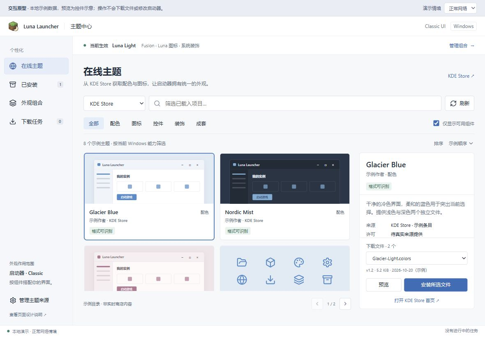
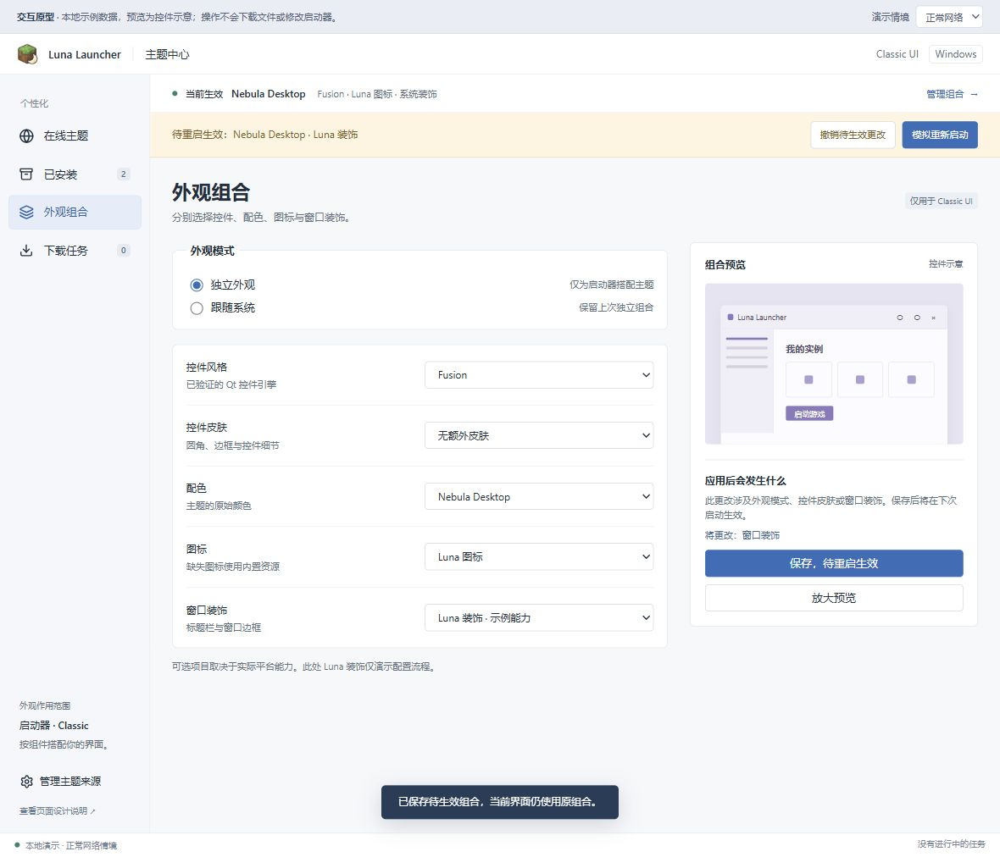

# Classic UI 主题中心：页面与交互设计

状态：原生 Qt Widgets 主题中心已实现，详见 [实现、用法与验证记录](CLASSIC-UI-THEME-IMPLEMENTATION.md)。下文保留页面设计与验收目标；配套[可交互原型](design/classic-theme-center.html)使用明确标注的本地示例数据，不联网、不安装文件、不修改启动器设置。原型中的主题预览由控件示意绘制，不是商店作者截图，也不是 Qt 实际渲染结果。





本设计承接 [Classic UI 主题系统方案](CLASSIC-UI-THEME-PROPOSAL.md)。目标是让用户从 KDE Store 获取兼容组件，并在启动器内部组合控件风格、配色、图标和窗口装饰。作用范围始终为 Classic UI；不修改 Windows/macOS/Linux 的全局桌面设置。

## 1. 入口与窗口

外观设置中的“下载主题”升级为“主题中心…”，打开可调整大小的非模态 Qt Widgets 窗口。同一应用进程只创建一个主题中心，重复打开时激活已有窗口。关闭窗口不取消已经提交的安装任务；任务仍在统一任务中心显示。

建议默认 1180 × 780 逻辑像素。左侧为固定功能导航，内容区使用 QStackedWidget 保留页面状态；在线页使用 QSplitter 分隔列表与详情。屏幕较窄时详情改为单独一页，有返回列表按钮并恢复选中项和滚动位置。文字随系统字号增长，避免把整页固定在一个绝对像素尺寸中。

导航包括：

- **在线主题**：来源、搜索、分类、排序、兼容过滤、列表与详情。
- **已安装**：包版本、来源、更新、使用状态、卸载和打开目录。
- **外观组合**：系统/独立模式，配色、图标、控件和装饰搭配，生效状态。
- **下载任务**：获取、校验、解压、扫描、发布各阶段与取消/重试。

窗口页头保持“当前生效”摘要，待重启组合单独显示。浏览一个主题、下载安装一个包、选择组合和实际生效是四个不同动作。

## 2. 在线页

```text
主题中心                       当前生效：Luna Light · Fusion · 系统装饰
┌──────────┬─────────────────────────────────┬───────────────────────┐
│ 在线主题 │ 来源 [KDE Store ▼]  搜索… [刷新] │ 所选主题 / 状态        │
│ 已安装   │ 全部 配色 图标 控件 装饰 成套     │ 作者预览 / 控件预览    │
│ 外观组合 │ 排序 [评分 ▼]  ☑ 仅显示可用组件  │ 说明、作者、来源、许可 │
│ 下载任务 │                                 │ 支持与不支持的部分     │
│          │ 主题列表：预览 / 名称 / 兼容性   │ 下载文件 [下拉列表 ▼] │
│          │          / 作者 / 安装状态       │ 版本、大小、更新时间   │
│          │                                 │ [预览] [安装所选文件] │
│ 来源设置 │ [上一页] 第 1 页 [下一页]        │ [在商店中打开 ↗]      │
└──────────┴─────────────────────────────────┴───────────────────────┘
```

使用中等密度的主题卡片，缩略图是主要视觉信息；不添加与下载无关的营销横幅。选择卡片更新详情，不立刻下载。卡片整块可键盘聚焦，有清晰选中框；名称不能只靠悬浮提示才能看到。

详情的标题、文件选择和安装操作固定可见，中间说明区独立滚动。避免说明或图片过长时把安装按钮挤出视口；大图通过“预览”打开。HTML 原型在 700 像素以下纵向排列列表与详情，正式 Qt 窄窗口采用上述详情子页。

默认来源为 KDE Store，现有 GitHub 来源继续保留；来源之间不混用分类 ID。用户搜索默认只筛选已经取得的列表，明确显示“筛选已载入项目”；接入服务器检索须先验证 provider 的实际语义，不将本地筛选伪装成全站搜索。刷新仅更新当前查询，旧列表可继续查看。

分类映射来自已核对的接口，后续以 provider 返回的目录及能力为准：

| 页面分类 | Provider / OCS 分类 | 首版行为 |
| --- | --- | --- |
| 配色 | api.kde-look.org / 112 | 解析 `.colors`，支持独立配色 |
| 图标 | api.kde-look.org / 132 | 检查 `index.theme`、继承、内部链接与应用图标回退 |
| 控件 | api.opendesktop.org / 123（Kvantum） | 无已验证引擎时可浏览，显示不可应用原因 |
| 窗口装饰 | api.kde-look.org / 717（Plasma 6） | Aurorae/KDecoration 不直接等同于 Luna 装饰 |
| 成套主题 | api.kde-look.org / 722（Plasma 6） | 逐组件分析；不得把整个 Plasma 桌面主题标成可用 |
| Plasma 桌面主题 | api.kde-look.org / 104 | 默认兼容过滤下隐藏，不承诺面板/桌面支持 |

分类仅用于发现。目录阶段显示“配色格式可识别 / 安装前检查”，文件分析通过后才显示确切兼容结论。多文件主题必须列出每个文件名、版本、大小、上传时间与对应组件，不自动安装第一个附件。

兼容标签为：**可用**、**部分可用**、**待检查**、**当前平台不支持**。部分可用必须逐项说明，例如“可导入配色；Plasma 面板和 KWin 特效不可用”。“仅显示可用组件”包含部分可用但至少有一个可安装组件的条目；不包含尚不能确认格式的条目，可取消过滤查看。最终安装资格由下载后扫描确定。

详情显示真实来源及作者信息；缺少许可显示“来源未提供许可”，不默认填开源许可。作者截图与本机控件预览分开，前者可能包含本机不支持的桌面效果。商店网址使用普通外部链接，主题描述按纯文本或经过清理的富文本展示。

## 3. 安装、预览、应用

1. 选择文件，检查来源和格式，点击“安装所选文件”。第一次安装部分兼容包时展示可选组件，不能选择不支持的项。
2. 创建安装任务，重新解析下载地址；显示获取、校验、解压、扫描、发布的实际阶段。未知总字节时使用不确定进度，不填假百分比。
3. 验证后发布到私有主题目录。失败或取消保留已安装版本和当前外观；错误显示在任务及详情中，可重试。
4. 成功后显示“已安装，可应用”，按钮变为“配置使用”。当前外观不随安装变化。
5. 在外观组合页选择组件，先预览再应用。预览用独立 Qt 进程，覆盖按钮、列表、输入、菜单、禁用态、日志与标题栏。
6. 后端返回可热换时更新当前生效摘要；需重启时明确显示“下次启动生效”，提供撤销。重启是用户单独动作，有运行任务时给出任务说明，不自行结束游戏或后台工作。

原型演示：配色安装、取消/重试、模拟失败、部分兼容包、系统/独立切换、需要重启的组合和撤销。原型中“模拟重新启动”只推进内存状态；刷新网页会重置示例。

## 4. 外观组合

系统外观与独立外观是一级模式；“随系统切换明暗”是独立配置项。切回系统模式保留上次独立组合。用户能看到哪个部分由系统提供，哪个部分由启动器提供。

| 组件 | 控件及说明 |
| --- | --- |
| 控件风格 | QStyle 选择；同一时刻一个引擎，Fusion/Breeze 等由实际能力提供 |
| 控件皮肤 | 可选 Luna QSS 包；不支持当前 QStyle/配色时禁用并说明 |
| 配色 | 已安装 `.colors` 或主题内配色；使用原始配色与自定义强调色要区分 |
| 图标 | 独立图标包；显示继承关系与内置图标回退说明 |
| 窗口装饰 | 系统 / Luna 自定义；KDE 上优先系统装饰，支持时可同步应用配色 |

应用前列出“将变化的组件”和具体重启原因。成套预设只预填组合，用户可以保留当前图标或系统标题栏，不强制覆盖全部选择。未验证 Windows/macOS 构建的 Breeze/Kvantum 不出现在“可选引擎”列表中。

已安装页按包展示，展开后可查看组件。使用中、待生效或作为其他包依赖的组件不能直接删除；给出“先更换组合”操作。更新先安装新版本，当前进程保留其正在引用的旧版本，按相同应用规则切换；绝不边运行边覆盖任意 QSS/装饰资源。

## 5. 加载与状态一致性

| 情况 | 页面反馈与状态要求 |
| --- | --- |
| 第一次加载 | 列表局部加载提示；导航、来源可操作 |
| 刷新或翻页 | 保留旧内容，显示当前查询加载；成功翻页滚到列表顶部，失败保持原页 |
| 快速换来源/分类 | 每个查询递增 generation，旧响应不覆盖新列表 |
| 详情/截图较慢 | 按主题 identity 和 generation 更新，不能把前一个主题的预览贴到后一个上 |
| 返回在线页 | 保留来源、查询、页码、选择与滚动位置，不重新创建模型 |
| 离线且有缓存 | 显示缓存时间与“离线”，可浏览，安装操作解释网络要求 |
| 无缓存/网络错误 | 内联错误和重试，不弹循环消息框 |
| 结果为空 | 保留筛选器，提供清除筛选按钮 |
| 安装中关闭窗口 | 全局任务继续；重开从任务服务读状态 |
| 多窗口修改外观 | 用 baseRevision 提交，冲突时重读状态并保留可重新审阅的草稿 |
| 取消与完成同时发生 | 以后端事务终态为准；发布完成不能被迟到取消改回未安装 |

requestId 用来关联每次请求；operationId 识别安装任务；revision 表示已提交外观状态。三者职责不同，不能仅靠“所有请求有 ID”解决过期响应、重复提交和配置冲突。安装还需幂等键（provider/contentId/fileId/version/target）；进度事件带 operationId 和单调序号。

OCS 需检查 XML `<meta>` 业务状态；HTTP 200 不代表成功。分页以服务实际返回的数据为准，不能假定 pagesize 被接受。下载链接可能带短期签名，缓存条目身份，不长期缓存签名 URL。失败重试有界，离线返回缓存时不覆盖其真实来源和更新时间。

## 6. Qt 与共享后端落点

| 现有位置 | 拟议改动 |
| --- | --- |
| `launcher/ui/widgets/AppearanceWidget.cpp` | 外观设置保留核心选择与摘要，增加主题中心入口 |
| `launcher/ui/dialogs/ThemeDownloadDialog.*` | 迁移为 ThemeCenterWindow；保留旧入口兼容，不继续扩充单列 GitHub 资产树 |
| `launcher/api/LauncherApiAppearance.cpp` | 将下载、校验、扫描和安装事务抽到共享服务，Classic 与 API 走同一路径 |
| ThemeCatalogModel / ThemeFilesModel（新增） | QAbstractListModel + delegate；按 identity 增量更新；截图异步加载 |
| ThemeCenterController（新增） | 保存各页查询/选择、草稿与取消标识；不承担网络和解包逻辑 |
| OcsThemeProvider / GitHubThemeProvider（新增） | 同一目录接口，provider 特有分类、分页和文件解析在内部处理 |

已有 API 包括 `appearance.sources/release/install/remove/catalog/refresh/select`。建议在保留这些入口的同时扩展下列协议；这些名称目前是设计，不代表已实现：

| 拟议操作 | 核心输入 / 输出 |
| --- | --- |
| `appearance.capabilities` | target/platform → 格式、引擎、装饰、热切换能力 |
| `appearance.query` | provider/category/sort/page/query → 项目、分页、缓存时间 |
| `appearance.files` | provider/contentId → 可下载文件及预检查信息 |
| `appearance.install` 扩展 | provider/contentId/fileId/components/idempotencyKey → operationId |
| `appearance.preview` | 私有主题版本及草稿 → 独立预览会话 |
| `appearance.state` | requested/effective/pending/revision + 各组件来源 |
| `appearance.apply` | target=classic/baseRevision/组合 → effective/pending/重启原因 |

QNetworkAccessManager + 现有 NetJob 承担网络工作；OCS XML、包扫描及缩略图解码不阻塞 GUI 线程。截图缓存和目录缓存进入应用统一缓存管理；清理缓存不删除已安装包，不在安装期间删除它正在读取的临时文件。原生文件选择器用于本地导入。

当前实现支持 KDE 配色和图标、Prism/GitHub 主题包，以及 Luna v2 的控件、配色、图标、背景与装饰组件。Kvantum、Aurorae 和 Plasma 效果可浏览并显示能力限制，不会作为可用引擎自动应用。

## 7. 实施验收

- Windows/macOS/非 KDE Linux 的目录、文件选择、安装与恢复按相同协议运行；实际可用引擎由能力接口决定。
- 配色导入前后、仅安装不应用、应用后再开对话框、重启和回系统模式分别核对。
- 同一主题多附件、签名过期、OCS 业务错误、服务忽略 pagesize、离线缓存都能完成明确反馈。
- 快速切页、连续搜索、刷新失败和过期详情不会清空列表、串图或覆盖正在编辑的组合。
- 重复安装、取消临界点、安装失败、被引用包卸载、更新中的旧版本都有可恢复状态。
- 100–200% DPI、大字体、键盘导航、屏幕阅读器及窄窗口布局通过；作者截图缺失时有稳定占位。
- 原型中的模拟操作不能被当作发布包功能验收；正式接入须以实际 OCS、Qt 预览进程和本地安装目录验证。

## 8. 本轮原型验证记录

已在浏览器中实际操作验证多文件选择、安装成功、配置后单独应用、失败、重试、取消、部分兼容组件选择、待重启状态及撤销、离线刷新保留目录、分页、搜索空结果，以及不支持格式禁用安装。1180 × 820、820 × 780、560 × 780 的布局已检查，没有横向溢出。详情安装按钮在桌面视口内可见，运行日志没有脚本错误。

这是原型交互和布局验证；OCS 真正联网、原生窗口行为、主题实际渲染与安装安全仍按上面的正式验收清单实施。
