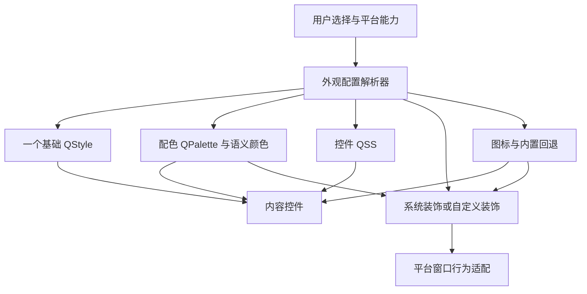

**Classic UI 跨平台主题与窗口装饰方案**

研究日期：2026-10-26。本文保留研究结论与设计目标。原生主题中心、组件安装、状态管理和隔离预览已实现；实际支持范围、命令与验证记录以 [实现文档](CLASSIC-UI-THEME-IMPLEMENTATION.md) 为准，文中后续阶段的引擎兼容仍属于规划。

推荐路线是：保留现有主题格式，以 Fusion 为跨平台基线，引入 KDE 配色解析和 OCS 主题来源，再增加一套由 QSS、SVG 和声明式配置组成的 Luna 主题包。窗口装饰作为独立组件：KDE/KWin 下优先复用系统装饰及原生配色同步，用户选择自定义装饰时由应用绘制外观、平台适配层维持窗口行为。Breeze、Kvantum 和 Aurorae 兼容分别扩展，不作为第一版的前置条件。本文第 15 部分补充了 KDE 自身实现链路及由此产生的方案修正。

这能同时满足 Windows、macOS 和非 KDE Linux 用户使用主题，以及 Linux 用户选择跟随桌面或只改变启动器外观。可兼容的单位应是配色、控件样式、图标、窗口装饰等具体组件，而不是把 KDE 商店里的所有内容视为同一种“Qt 主题”。

**1. 研究结论与证据。** “控件主题与窗口装饰可以叠加”成立，准确说是组合使用；控件主题内部还有自己的优先级。



| 组件 | 负责的内容 | 组合规则 |
| --- | --- | --- |
| QStyle | 控件基础绘制、尺寸和行为提示 | 同时一个：Native、Fusion、Breeze、Kvantum 等互斥 |
| QPalette / 语义配色 | 背景、文字、选中态、禁用态等 | 可以独立选择，原生样式可能只采用部分颜色 |
| QSS | 控件边框、间距、圆角、图片与局部颜色 | 建立在 QStyle 上；显式颜色可能覆盖配色 |
| 窗口装饰 | 标题栏、窗口按钮、边框与拖拽区外观 | 独立于内容区，可跟随控件主题或单独选择 |
| 图标 | 工具栏、设置、操作按钮等图标 | 独立选择，缺失项必须回退 |

因此可以组合“Fusion + KDE 深色配色 + Luna 控件 QSS + 某套窗口装饰 + Breeze 图标”。不能把 Fusion、Breeze、Kvantum 当作三套基础样式一起叠加；也不能把两份任意第三方 QSS 拼接后承诺没有冲突。

已完成的证据分为三类：

| 验证 | 结果 | 能说明的范围 |
| --- | --- | --- |
| 本项目源码核对 | 已完成主题加载、设置、安装 API、图标和 macOS 标题栏路径检查 | 确认可复用部分和现有缺口 |
| KDE OCS 实际请求 | provider、分类、列表、文件下载解析均成功 | 证明可以从正式服务获取主题数据，不必抓取网页 |
| Windows 隔离实验 | 实际 `.colors` 文件转换后，现有 API 安装、选择、重启保留均通过 | 证明配色接入链路可行，未验证完整颜色语义或窗口视觉效果 |

实验素材来自 [Nothing Plasma Dark 的商店页面](https://store.kde.org/p/2379809)，下载文件为 `NothingPlasmaDark.colors`，SHA-256 为 `d7c24d60ee19478785012b4855e7e1b27b301fee33e12509533058a89b12f4e6`。实验使用 Windows Qt offscreen 后端和临时数据目录，把 13 个主要配色角色转换成现有主题格式；没有 GUI 截图，也没有 Linux/macOS 运行验证。实验中的简化转换器不能作为正式 KDE 配色实现直接发布。

原始资料与实验结果保存在 [研究目录](../build-meson-neo-ui/kde-theme-research/)；其中 [结果 JSON](../build-meson-neo-ui/kde-theme-research/palette-proof-result.json) 记录安装和持久化结果。该目录属于构建产物，清理后可能消失，本文保留关键结论和来源。

**2. 仓库现状决定了需要先补状态管理。** 现有代码已经有基础主题、图标和下载安装功能，无需另建一套完全平行的系统。

| 现有位置 | 当前实现 | 本次方案中的处理 |
| --- | --- | --- |
| `launcher/ui/themes/ThemeManager.cpp` | 缓存启动时的 style/palette；扫描内置及用户主题 | 升级为组件目录、配置解析和统一生效入口 |
| `launcher/ui/themes/ITheme.cpp` | 清空 QSS → 换 QStyle → 设置 palette → 设置 QSS → 设置资源搜索路径 | 拆分解析与生效；资源路径先准备；完整切换遵循重启策略 |
| `launcher/ui/themes/CustomTheme.cpp` | `theme.json` + QSS；基础颜色和统一禁用态混色 | 保留旧格式；增加 v2 loader 和 KDE `.colors` provider |
| `launcher/ui/themes/SystemTheme.cpp` | 非首次切回系统可能用启动时缓存 palette | 系统模式启动时不覆盖平台配色；切回时清除自定义状态 |
| `launcher/ui/themes/ThemeManager.mm` | 修改 NSWindow 背景、明暗 appearance，并监听新窗口 | 纳入窗口适配层；回系统时撤销 appearance、背景及 observer 覆盖 |
| `launcher/ui/widgets/AppearanceWidget.cpp` | 下拉选择直接写设置并调用 apply | 展示保存值、实际值和待重启值；由统一服务提交 |
| `launcher/ui/dialogs/ThemeDownloadDialog.cpp` | GitHub Release 主题包来源与安装流程 | 改为共用仓库/安装服务，增加 OCS 来源 |
| `launcher/api/LauncherApiAppearance.cpp` | `sources/release/install/remove/catalog/refresh/select`，有 staging 和失败回滚 | 抽取共享服务，保留旧接口适配，补异步任务和组件选择 |
| `launcher/ui/themes/IconTheme.cpp` | freedesktop `index.theme` | 扩展导入及缺失图标回退，无需重写格式 |
| `launcher/archive/ArchiveReader.cpp` | libarchive，已启用多种格式/filter | 复用解包，验证发布包实际包含的压缩格式能力 |
| `launcher/Launcher.in` | 强制 `QT_QPA_PLATFORMTHEME=xdgdesktopportal` | 审查与 KDE/qt6ct/系统主题集成的关系，保留文件选择器能力 |

需要处理的具体问题：系统配色缓存不是实时系统状态；当前 macOS 标题栏覆盖没有和“跟随系统”形成完整状态转换；全局 `theme:` 资源前缀不适合同时预览多套主题；现有图标 fallback 不足以保证本项目自定义图标名在任意 KDE 图标包中都有对应项。

现有安装器还会跳过所有非普通文件，包括符号链接。许多 Linux 图标包以链接复用图片，直接沿用此行为会出现安装成功但缺图标的情况，必须在导入适配中明确处理。

**3. KDE 内容按类型接入。** 第一版的“支持 KDE 主题”应明确列出兼容组件，并在商店列表标注安装后实际能改变什么。

| KDE/Qt 内容 | 第一版策略 | 后续扩展或限制 |
| --- | --- | --- |
| Plasma Color Schemes，`.colors` | 正式支持 Windows/macOS/Linux | 使用 KColorScheme；配色不等于完整 KDE 控件外观 |
| Full Icon Themes，`index.theme` | 支持兼容导入，补链接处理和应用图标回退 | 非标准扩展、缺失继承主题显示兼容信息 |
| 本项目 `theme.json` / QSS | 继续支持 | 新增 v2 组件式主题，不改变旧包解析含义 |
| Breeze Application Style | 第一版采用 Fusion | 后续随发布包编译提供稳定兼容的 Breeze QStyle |
| Kvantum `.kvconfig + .svg` | 显示需要相应引擎，暂不标记可应用 | 先验证 Linux 进程内独立配置，再验证 Windows/macOS |
| Aurorae SVG/rc 装饰 | 不宣称原生兼容 | 后续转换静态资源、边框参数和按钮状态子集 |
| KWin C++/QML 装饰 | 可查看来源和说明 | 不能作为跨平台 Qt Widgets 主题直接执行 |
| Plasma Desktop Theme / Global Theme | 标注桌面主题或组件集合 | 后续仅导入识别出的兼容组件；桌面布局、面板、特效不适用于启动器 |

KColorScheme 官方支持 Windows、macOS、Linux 等平台，不要求用户安装 KDE 桌面。正式配色路径建议使用 `KColorScheme::createApplicationPalette()` 和以 `KConfig::SimpleConfig` 打开的包内配置，保留 Active/Inactive/Disabled、链接、阴影等 Qt 可表示的角色。Header、Positive、Negative 等超出通用 QPalette 的语义应额外保留为 token，并由对应控件使用；不能声称所有 KDE 专属表现都能通过一个 palette 自动复现。

不要直接照搬 `KColorSchemeManager` 的 Default 行为：它在非 KDE 平台会按系统明暗选 Breeze/Breeze Dark，这不等于精确跟随 Windows/macOS 原生主题。底层颜色解析可以复用，用户模式由本项目管理。

当前构建脚本固定 Qt 6.10.1；CMake 仍声明最低 Qt 6.4。已检查的 KColorScheme 6.19.0 要求 Qt 6.7，并在 Qt 6.10 下依赖 QtGuiPrivate，另需 KF6 Config/GuiAddons/I18n。它是可评估的稳定版本基线，不代表已经完成依赖构建验证。完整发布包固定兼容版本、附带依赖；保留旧 Qt 构建时通过能力开关禁用未满足依赖的功能，不能悄悄提高整个项目的最低要求。当前 Breeze master 已要求 Qt 6.11，不适合直接接入现有 Qt 6.10.1 构建。

**4. 新主题格式以兼容现有目录为基础。** 建议导入包仍使用 `themes/<packageId>/theme.json`，通过 `schemaVersion: 2` 选择新 loader。缺少版本字段的包走旧 loader；未知版本给明确错误。原有安装目录和纯 QSS 主题继续作为 legacy 条目保留。

拟议目录示例：

```text
themes/luna-classic/
  theme.json
  widgets.qss
  palettes/light.colors
  palettes/dark.colors
  decoration/decoration.json
  decoration/titlebar.qss
  resources/chrome/close.svg
  resources/chrome/maximize.svg
  resources/chrome/restore.svg
  resources/chrome/minimize.svg
  icons/luna/index.theme
  icons/luna/scalable/...
  preview.png
  LICENSE
```

示例 manifest 表达字段职责，最终实现还需配套 JSON Schema 和版本迁移测试：

```json
{
  "schemaVersion": 2,
  "id": "luna-classic",
  "name": "Luna Classic",
  "version": "1.0.0",
  "license": "SPDX-ID",
  "components": {
    "widgets": {
      "engine": "fusion",
      "qss": "widgets.qss",
      "paletteBinding": "semantic"
    },
    "palettes": {
      "light": { "format": "kde-colors", "file": "palettes/light.colors" },
      "dark": { "format": "kde-colors", "file": "palettes/dark.colors" }
    },
    "decoration": {
      "renderer": "luna-widgets",
      "config": "decoration/decoration.json",
      "qss": "decoration/titlebar.qss",
      "paletteBinding": "selected"
    },
    "icons": { "directory": "icons/luna", "fallback": "builtin" }
  },
  "defaults": {
    "paletteVariant": "dark",
    "decoration": "bundled"
  }
}
```

组件可省略：只有配色、只有装饰、只有图标的包都合法。主题包提供推荐组合，但安装不会自动修改当前选择；用户点击“应用整套”才同时选择各组件。用户可以随后单独换装饰或图标，不被控件主题重新覆盖。稳定引用使用包 ID、组件 ID 和 variant，不保存不可迁移的绝对路径。

上述树是交换格式。新安装服务把导入后的组件保存到启动器数据目录下 `theme-packages/<packageId>/<contentHash>/` 的不可变版本目录，catalog 记录已安装版本和所选版本。扫描用户手动放入 `themes/` 的包时沿用原入口，v2 包在正式使用前导入版本目录；legacy 包保持原加载方式。包内图标目录由 catalog 注册到图标搜索路径。这样资源引用固定到实际生效版本，更新不会覆盖已打开窗口正在读取的文件。

装饰配置包含标题栏高度、按钮尺寸与间距、内容边距、活动/非活动颜色、常规/最大化/全屏布局和 SVG 资源。尺寸采用逻辑像素，并受程序定义的可用范围约束；字体遵循系统和用户缩放，长标题可省略，按钮提供可访问名称。布局变化不能缩小到无法点击或无法拖动。macOS 使用原生窗口按钮时，配置中的自绘按钮图案不参与渲染，设置页展示实际效果。

QSS 的具体规则：

- 尽量使用 `palette(window)`、`palette(text)` 等 Qt 原生配色引用。新包声明是否支持独立配色；硬编码颜色的 legacy QSS 不标记为完整兼容自选配色。
- Qt QSS 没有 Web CSS 的 `var(--...)` 和媒体查询。必要的自定义 token 由受控预处理器替换为合法 QSS，未识别 token 报错；需要重写 QSS 的变化不能默认归入即时配色更新。
- v2 控件 QSS 挂在已登记的内容根，窗口装饰 QSS 只挂在专用标题栏根。菜单、独立弹窗、浮动 dock 等作为独立主题表面登记，避免标题栏被通用 `QWidget` 规则污染。
- 旧的应用级 QSS 保留原有作用域。旧 QSS 与自定义装饰的组合需额外兼容检查，不能以新格式的隔离保证覆盖任意旧主题。
- 资源先解析再应用；每个包/版本使用独立资源命名空间。校验所有 manifest 路径和 QSS `url()`，只允许包内资源及显式允许的内置资源，拒绝跨包目录和外部路径。CSS 解析不能只用一个正则替换。
- 控件自己的 stylesheet 优先级可能高于应用样式，需要核查本项目已有局部 QSS，移除可替换的硬编码颜色并保留必要的语义状态。

**5. 设置页面采用清楚的组合关系。** Classic 的“外观”中设置五组内容，而不是把每个技术参数都平铺给用户。

| 分组 | 用户可见选项 | 行为 |
| --- | --- | --- |
| 外观模式 | 跟随系统 / 启动器独立外观 | 跟随系统时恢复平台控件样式和配色；保存但暂不使用独立配置 |
| 控件与配色 | 控件主题；配色方案；浅色/深色/跟随系统明暗 | “跟随系统明暗”只切所选主题的明暗变体，仍属于独立外观 |
| 窗口装饰 | 系统装饰 / 跟随所选主题 / 独立选择 | 独立于控件主题；显示当前平台能力和实际采用方案 |
| 图标 | 跟随系统 / 内置 / 已安装图标包 | 保留应用专属图标回退；不替换本项目品牌标识 |
| 主题管理 | 在线主题、已安装、本地导入、预览、更新、移除、恢复默认 | 来源、作者、许可、兼容组件、体积及版本可查 |

“跟随系统”预设默认搭配系统装饰和系统图标；用户在高级组合中仍可单独覆盖装饰或图标，界面显示“系统控件外观 + 独立窗口装饰”等实际组合，避免一个总开关掩盖局部覆盖。

Linux 的系统模式尊重当前 Qt 平台集成。KDE/qt6ct/其他桌面能提供多少信息取决于已加载的 platform theme；portal 通常只提供明暗等部分偏好，不能承诺完整复现 GNOME GTK 控件外观。独立模式使用本程序主题目录，不写 `kdeglobals`、全局 Kvantum 配置或系统图标目录，不改全局 `XDG_CONFIG_HOME`。

当前启动脚本为文件选择器强制 portal 插件，需要改为尊重已有显式平台配置，并对发布包的默认插件选择进行验证。外观选择与 portal 文件选择器要分别建模；不能为了主题跟随直接删除 portal 配置，造成沙箱访问或文件选择器回退。

**6. 状态和生效策略必须可观察。** 后端维护用户期望配置 `requested`、当前实际配置 `effective`、待重启配置 `pending`、最后可用配置 `lastKnownGood`，并给整个状态一个单调递增 `revision`。前端直接展示后端返回的状态，不以“设置文件写入成功”等同于“窗口已经换肤”。

建议配置字段为 `mode`、`widgetThemeRef`、`paletteRef`、`colorMode`、`decorationMode`、`decorationRef`、`decorationPaletteRef`、`iconMode`、`iconThemeRef`。`decorationPaletteRef` 默认继承内容配色，也允许独立设置。系统模式下保留上次独立组合；重新选择独立模式时恢复该组合。

没有浅色变体的单配色包不能在“自动”模式下强行反色。应显示“此方案只有深色”，按用户固定选择应用；只有明确的明暗配对或内置映射才能自动切换。

| 操作 | 推荐生效方式 |
| --- | --- |
| 下载、安装、更新缓存、刷新目录 | 只更新目录和任务状态，不改变已生效外观 |
| 同一引擎和结构下的受控 palette 更新 | 可即时更新；验证已有窗口、新窗口、菜单、日志和图标染色 |
| 系统明暗变化，且当前主题支持动态配色 | 合并重复事件，更新 palette/语义颜色，不重建主窗口 |
| 更换图标包 | 更新图标缓存和实际持有图标的视图，不重建整个窗口 |
| 任意第三方 QSS、更换基础 QStyle | 默认保存为待重启，支持独立预览 |
| 系统装饰与自绘装饰互换 | 默认待重启，避免窗口句柄重建破坏状态 |
| 同一自绘框架中只改变受控颜色/按钮图片 | 通过验收后允许即时更新 |
| 返回完全跟随系统 | 涉及 QSS、QStyle 或窗口结构时首版采用重启完成；仅 KDE 原生 palette 覆盖的路径，验证清除配色属性并恢复平台 palette 后可即时恢复 |

Qt 文档存在版本差异：当前 [Qt 6 总览](https://doc.qt.io/qt-6/stylesheet.html) 明确建议首次显示窗口前设置应用 QSS，并提示运行时切换可能留下部分旧样式；[Qt 6.10 文档](https://doc.qt.io/qt-6.10/stylesheet.html) 和 `v6.10.1` 的 qdoc 尚无该提示。因此不能把它表述为“Qt 6.10 禁止热切换”，也不能据此承诺清空再设置就一定可靠。上述策略是本项目为可靠性选择的默认行为。

系统模式应在启动时保留 Qt 平台自身的样式与 palette 管理，避免先加载自定义再用启动时快照恢复。监听适用 Qt 版本的系统明暗、palette 和字体变化；用事件来源/应用中标记避免把自己设置 palette 触发的事件当成系统变化。平台只提供部分状态时，记录有效能力而不是虚报完整跟随。

“跟随系统高对比度与减少动画”默认开启，作为可访问性偏好单独保存。平台报告高对比度时，effective 使用受支持的高对比度配色及清晰边界，停用影响可读性的透明效果；平台恢复后回到用户原组合，requested 不被覆盖。主题不支持这种即时切换时，不能仍显示“已启用高对比度”，应明确有效能力和必要的重启。减少动画同样传递给装饰渲染器。

macOS 回系统时撤销本程序设置的 `NSWindow.appearance` 等覆盖，恢复原生属性并停止相应 observer；KDE 相关 `KDE_COLOR_SCHEME_PATH` 应用属性也随模式撤销。原生状态需要在首次修改前记录，不能用另一个主题的值充当默认值。

请求 ID 是关联基础，仍需版本约束：查询带 `requestId + queryGeneration`，修改带 `requestId + expectedRevision`，安装带 `operationId`。旧列表/旧预览响应不得覆盖新选择；提交冲突返回新状态供重新编辑；重复安装请求按操作 ID 去重。异步事件带状态 revision，取消下载后禁止迟到回调继续发布包。所有 GUI 生效在主线程执行，解析和下载完成前不能提前写入“已应用”。

**7. 窗口装饰采用应用外观与系统行为分离的实现。** 系统装饰路径保留原生框架，在 KDE/KWin 下优先通过现有协议同步应用配色；这条路径不需要自绘标题栏。自定义装饰路径首选评估 QWindowKit 的 Widgets 模块，外面封装本项目 `WindowChromeController`。主题只描述画法；移动、缩放、最大化、系统菜单等由框架和平台适配负责。只需 Qt Widgets，不为此引入整套 Qt Quick/KWin。

QWindowKit 是 Apache-2.0，官方声明支持 Windows、macOS 11+、Linux，提供 system button roles 和原生窗口行为处理；它使用 Qt private API，需固定版本和工具链。当前只完成源码/文档评估，没有在本项目构建和实机验证。进入正式实现前，先用与发布包相同的 Qt 构建小验证程序；适配失败的平台保留系统装饰。

| 平台 | 自定义装饰目标 | 必须保留的行为 | 能力边界 |
| --- | --- | --- | --- |
| Windows 10/11 | 自绘标题栏和按钮，尽量保留系统边框 | 拖动、缩放、双击最大化、系统菜单、任务栏、DPI、Snap | Windows 11 最大化按钮须参与 `HTMAXBUTTON` 命中测试；模糊/圆角按系统能力启用 |
| macOS | 自定义标题栏背景与内容，默认保留原生红黄绿按钮 | 原生全屏、Spaces、缩放、菜单栏、可访问性 | 不承诺任意皮肤能完整替换原生按钮；系统特效有版本限制 |
| KDE/KWin 原生路径 | 保留 KWin 装饰，支持时同步应用配色 | KWin 自身的标题栏、按钮、缩放和窗口管理行为 | 配色同步不等于单应用选择任意 KWin 装饰插件；取决于平台插件、协议和配置文件可见性 |
| Linux X11 | QWidget 标题栏/边框 + 系统移动缩放 | 窗口管理器交互、最小化/最大化、多屏、系统菜单 | 阴影、圆角、合成效果依赖 WM；不要求 KDE |
| Linux Wayland | 客户端装饰，按协议与 Qt 能力请求移动缩放 | `startSystemMove/Resize`、最大化/全屏、缩放和输入 | 不通过全局坐标 `move()` 模拟拖动；装饰协商和系统菜单依赖 compositor |

Wayland 的“系统装饰”表示交给 Qt/平台采用默认装饰路径，未必是服务端绘制的标题栏。所有平台的透明、阴影和模糊都是可选效果，缺少能力时显示实色背景，不能影响窗口可操作性。

接入顺序为 MainWindow → 设置与实例编辑窗口 → 其他普通对话框。注册具体窗口，不遍历所有 top-level widgets 强行加框。菜单、tooltip、下拉弹层、原生文件选择器和平台 sheet 等采用各自窗口类型；macOS 原生菜单栏保留。MainWindow 的菜单、工具栏、dock 和已有状态保存需要持续工作，不能简单把全部控件重建塞入一个新容器。

新窗口继承当前 `effective` 配置。活动/非活动、最大化/还原/全屏状态分别更新装饰；可点击控件从拖拽区排除，保持 Tab 导航和屏幕阅读器名称。窗口所在显示器改变时重新计算逻辑尺寸和命中区。

**8. 在线主题共用现有下载基础。** 用轻量 OCS provider 复用当前网络、任务、缓存和解包能力。KNewStuff 本身可跨平台，但引入其完整 UI/依赖链的收益低于在已有系统上增加 provider。

实际测试的 provider 与分类：

| 服务 | 已验证类别 | 用法 |
| --- | --- | --- |
| `https://api.kde-look.org/ocs/v1/` | 112 配色、132 图标、104 Plasma Themes、722 Plasma 6 Global Themes、717 Plasma 6 Window Decorations | 首版展示配色与图标；其他类别明确兼容状态 |
| `https://api.opendesktop.org/ocs/v1/` | 123 Kvantum，另有 QtCurve/Application Styles 分类 | 为后续引擎扩展使用 |

KDE 的 [provider 文件](https://autoconfig.kde.org/ocs/providers.xml) 指向 kde-look API。实测 kde-look 没有返回 Kvantum 分类，而 opendesktop 有。因此分类需按 provider 发现，不能把一个服务的分类 ID 硬套到所有来源。以上 ID 是研究时结果，服务返回数据才是运行时依据。

接口流程：`categories → content/data → content/download/{contentId}/{fileId}`。排序使用已核对的 `new/alpha/high/down`；分页按服务返回的 page/pagesize/total 判断，不能假定服务完全采纳客户端 pagesize。OCS 的 HTTP 成功与 XML meta 状态需要同时判断。

文件列表要展示文件名、格式、大小、版本、依赖和兼容组件，按用户选择下载。一个条目有多个文件时不能随意安装第一个。下载解析返回带期限的签名地址，持久化保存 provider/contentId/fileId，下载前重新解析；链接失效可重新解析后有限重试，不长期缓存带签名的地址。

列表与文字先显示，预览图异步懒加载。建议初始缓存策略：分类 7 天、目录/详情 6 小时，过期时可先展示缓存并标注时间后刷新；尊重服务的缓存控制和条件请求。签名下载地址不进持久缓存；预览图设置独立大小限额与 LRU 清理。清理缓存不删除已安装主题或用户选择。

HTTP 缓存与主题管理缓存应接入项目统一缓存服务，按命名空间区分，不把主题数据塞进 Minecraft 元数据缓存。主题管理面板能查看缓存体积、更新时间、清理预览/目录缓存，离线时仍能使用已安装主题。每个列表保持自己的筛选、页码和滚动位置，手动刷新只刷新对应模型。

**9. 安装与更新以事务完成。** 提取现有 staging/备份/回滚代码，Classic 对话框和 API 调用同一服务。服务处理来源差异后生成统一组件目录，避免 Classic 和另一前端分别维护解包规则。

安装步骤为：解析兼容性和所选文件 → 下载到临时区 → 校验大小及来源提供的摘要 → 探测实际格式 → staging 解包 → 识别组件 → 校验 manifest/资源 → 构建安装清单 → 提交目录 → 更新 catalog。计算本地 SHA-256 用于内容标识和完整性检查；来源没有可信摘要时，不把自己计算的 hash 显示成“官方验证”。

直接 `.colors` 可以自动生成带来源记录的 palette-only 包；含单层外壳目录的压缩包应识别真正组件根；多组件压缩包只安装明确识别和选择的组件。支持 tar.gz/tar.xz/zip/7z 的前提是对应发布包的 libarchive codec 已通过测试，不按扩展名承诺。

符号链接/硬链接须在 staging 中建立关系表，仅允许最终指向包内普通资源的链接，检测越界、环和缺失目标。为了兼容没有创建链接权限的 Windows 用户，优先把合法链接物化成普通文件，并把物化后的文件数和字节计入限额；不能只检查压缩包声明体积。目录链接首版可明确拒绝。图标包中的正常文件链接应可工作，非法链接给出具体失败原因。

沿用现有文件数量、大小、路径和重名校验，补齐解压实际输出字节、Windows 保留名、大小写碰撞、所有组件资源引用和图标继承循环检查。安装限额以项目常量统一控制，并在超过时报告实际限制。归档里附带的脚本、QML 插件和原生 DLL/SO 不作为主题安装指令执行；需要的渲染引擎随应用编译提供。

每个包记录来源 provider/content/file、原始 URL、作者、许可、安装时间、原始内容 hash 和转换器版本。相同显示名称但不同来源使用不同稳定 ID，避免互相覆盖；有可用更新时由用户选择更新，保持组件引用可解析。

更新正在使用的包应生成新版本目录，切换成功前保留当前有效版本；不能原地删掉旧图片让已打开窗口失效。v2 包内多组件随同一个不可变目录发布，再以事务更新 catalog；legacy 多组件跨 themes/icons 目录提交时，使用操作日志和恢复流程保证最终一致性，不能把多个 rename 称为一次跨目录原子操作。被当前、待重启或回退配置引用的版本受删除保护，移除前先选择替代组件。旧格式正在使用的包更新安排在重启前的受控提交阶段，避免沿用原地覆盖造成资源混用。

图标解析链为：当前图标主题及可用继承主题 → 应用图标别名映射 → 内置资源。对 `news`、`noaccount` 等项目自定义名称制定映射；程序品牌图标继续使用本项目资源。注册当前各视图实际使用的图标，主题变化时更新缓存和这些图标，不以刷新整个 MainWindow 替代图标通知。

**10. 建议的代码职责划分。** 新类名是设计名称，具体命名可依仓库风格调整。

| 服务/模块 | 责任 | 现有接入点 |
| --- | --- | --- |
| ThemeRepository | GitHub、OCS、本地来源，分类/查询/文件元数据 | ThemeDownloadDialog、appearance.sources/release |
| ThemePackageInstaller | 解包、转换、组件校验、安装/更新事务及来源记录 | LauncherApiAppearance 中现有安装逻辑 |
| ThemeCatalog / ThemeResolver | 包和组件目录、依赖及能力判断、有效组合 | ThemeManager 的扫描与选择 |
| PaletteProvider | legacy、KDE colors、系统配色和语义 token | CustomTheme、SystemTheme |
| SystemAppearanceProvider | 平台状态、明暗/字体/对比度通知、KDE 配色桥接、覆盖撤销 | Application、SystemTheme、ThemeManager.mm |
| AppearanceService | requested/effective/pending/revision，唯一提交入口 | AppearanceWidget 与 appearance API |
| WindowChromeController | 窗口登记、平台行为、装饰创建与状态同步 | MainWindow、普通 QDialog、macOS 原生辅助代码 |
| IconResolver | 图标继承、应用别名、内置 fallback、更新通知 | IconTheme、调用 QIcon 的视图 |

在现有 appearance API 上向后兼容扩展 `capabilities`、`state`、`query`、`files`、`preview`、`apply` 等能力；旧 `select` 进入同一个提交入口，不再独立写设置。安装返回 `operationId`，状态变更发带 revision 的事件，耗时解析不阻塞 GUI 线程。尚未生效返回 `requiresRestart` 和具体原因。

本轮主题渲染对象是 Classic 的 Qt Widgets。NeoUI 可以复用目录、下载、缓存和管理 API，但其 Vue/CSS 外壳不会自动获得 QSS 外观。API 明确 `target: classic` 与实际作用范围，避免用户在 NeoUI 保存 Qt 主题后误以为 Web 页面已经换肤；后续若统一配色 token，应另加 Web 渲染适配。

**11. 预览与恢复不依赖在主窗口反复换皮。** 增加专用主题预览模式，在独立进程中使用只读主题路径和临时设置快照，展示按钮、输入框、列表、树、选中态、禁用态、菜单、日志颜色与标题栏。该进程不打开账号、实例和后台下载服务，不竞争主数据目录的运行锁；拟议 `--theme-preview` 参数目前并不存在。

预览加载失败不改变已保存设置。用户正式应用完整皮肤时保存 pending 配置，提示需要重启；不在下载、启动游戏或仍有重要未保存界面状态时自行重启程序。

启动阶段在实际加载成功前保留 lastKnownGood；加载失败则恢复上一组合并提供原因。早期启动标记只覆盖主题初始化阶段，不能把后续任何游戏或网络崩溃都归因于主题。增加临时安全外观启动入口（拟议 `--safe-theme`），可绕过自定义 QSS 和装饰而不删除主题文件。首帧显示只证明初始化成功，不能证明第三方主题文字对比度合格，因此预览和安全入口都需要保留。

**12. 按可验收的阶段实施。** 推荐首个完整版本交付阶段 A–D，阶段 E 单独迭代。

| 阶段 | 交付内容 | 进入下一阶段的条件 |
| --- | --- | --- |
| A：基础与技术验证 | 统一状态模型、系统模式修正、legacy 迁移规则；以实际 Qt 工具链验证 KColorScheme 和 QWindowKit | 旧主题可用；来回切换不丢独立配置；两个依赖能在目标平台构建且关键窗口行为成立 |
| B：可用的 KDE 来源 | OCS 配色与图标浏览、下载、本地导入、缓存、共享安装器、图标回退 | Windows/macOS/至少一个非 KDE Linux 安装同一配色成功；失败安装不破坏当前主题；图标链接样本通过 |
| C：Luna 主题格式 | schema v2、受控 QSS、明暗配色、组件组合和预览；提供 Luna Light/Dark 成套样例 | 同一主题包在目标平台内容区可读、布局正常，旧包兼容；不支持的组合有明确状态 |
| D：跨平台窗口装饰 | WindowChromeController、主窗口和普通对话框适配、独立装饰设置与恢复 | Windows Snap、macOS 原生全屏、X11/Wayland 移动缩放及多屏 DPI 验收通过 |
| E：扩展生态 | 固定版本 Breeze；Kvantum 独立配置；Aurorae 静态子集转换 | 每种引擎/格式单独通过兼容矩阵，不能沿用 A–D 的测试结论 |

阶段 A 中先做窗口框架小验证，可以提前发现 Qt private API 或窗口管理器问题；正式 UI 接入放在 D。若某平台暂时不能通过 D，该平台发布时只开放系统装饰，KDE 配色、图标和控件主题仍可用，设置中明确显示原因。Linux 基础功能与 Windows/macOS 同属首版，不等到扩展引擎阶段才支持。

Kvantum 扩展尤其需要先解决它读取全局 `Kvantum/kvantum.kvconfig` 的行为。`WITHOUT_KF`、`WITHOUT_X11` 编译选项不等于已经支持所有 Windows/macOS 场景；需要私有主题路径/配置接口及工具链验证，不通过改整进程 XDG 配置目录来模拟独立选择。

Aurorae 的 SVG 路径确有 `decoration.svg`、按钮 SVG 和 `<theme>rc` 可分析，但现有渲染依赖 KDecoration3、KWin QML 接口和 KSvg FrameSvg 的切片/状态语义。后续转换器需识别这些元素和参数，形成自己的静态装饰包，报告未转换效果；不是把 SVG 文件改名就兼容全部 Aurorae。带脚本、原生插件、复杂动画或 KWin 特效的主题维持不支持状态。

**13. 验收覆盖功能、状态和发布包。** 自动测试优先验证解析/转换/事务/状态等稳定边界；窗口行为必须实机或对应桌面会话验证，offscreen 不可替代。

| 范围 | 必测场景 | 通过条件 |
| --- | --- | --- |
| 旧配置与旧主题 | 空配置、system、内置、自定义 JSON、纯 QSS、丢失主题 | 默认值明确；已有选择正确迁移；回退可恢复 |
| KDE 配色 | 明/暗、Inactive/Disabled、链接、Header/语义颜色、缺项/非法色值 | 与选定 KColorScheme 版本的输出比对，额外语义有明确消费方 |
| QSS 组合 | 自选配色、局部 stylesheet、菜单/弹窗、日志、标题栏 | 无残留资源、文字不可读或装饰污染；不兼容组合明确提示 |
| 系统跟随 | 应用启动前/后系统切明暗；独立→系统→独立 | 无事件循环；有效配置准确；独立选择保留；重启后确实回原生 |
| 异步状态 | 快速换来源/页码/预览、取消、重复提交、两个界面同时改设置 | 旧响应不覆盖新状态；revision 冲突可恢复；无重复发布 |
| 安装事务 | 越界、重复/大小写冲突、资源缺失、包内链接、环、解压超限、写入中断 | 不越界写入；当前包仍可用；失败原因明确；重启能恢复未完成事务 |
| OCS 网络 | XML 业务错误、分页差异、超时、签名 URL 过期、离线、缓存 304 | 重试有界；列表保留；缓存与安装状态一致 |
| Windows | 100/125/150/200% DPI、跨屏、Snap、任务栏、Alt+Space、最大化/全屏 | 拖动/缩放/点击区正确，无边缘空隙或重复系统按钮 |
| macOS | Intel/Apple Silicon 发布目标、原生按钮、Spaces/全屏、菜单、对话框 | 行为与原生窗口一致，回系统撤销覆盖 |
| Linux | KDE Wayland、GNOME Wayland、至少一套非 KDE X11；原生包及实际分发形式 | 无需 KDE 桌面即可独立应用；系统跟随与文件选择器正常 |
| 可访问性 | 键盘、焦点、屏幕阅读器、长文本/RTL、高对比度、大字体 | 焦点可见，按钮可访问，尺寸不截断必要操作 |
| 发布包 | 依赖/插件/资源路径、压缩格式、干净用户环境、缺失可选引擎 | 不依赖开发机全局库；能力表与实际构建一致 |

完整实现结束后，还应检查所有在应用期间新开的窗口、休眠恢复后窗口和主题卸载后的资源引用。只验证主界面启动截图不足以判定完成。当前仍需实测的内容是依赖打包体积、目标平台的 QWindowKit 运行表现、Qt private API 兼容性和各压缩格式 codec；本研究未把这些未测项算作已通过。

**14. 主要资料。** 以下是本次实际核对的官方文档、官方源码或项目上游资料；内容会随版本更新，实施时固定源码版本。

- [Qt 6.10 Style Sheets](https://doc.qt.io/qt-6.10/stylesheet.html)、[Qt 6 当前文档](https://doc.qt.io/qt-6/stylesheet.html)、[Qt 6.10.1 QSS 文档源码](https://github.com/qt/qtbase/blob/v6.10.1/src/widgets/doc/src/widgets-and-layouts/stylesheet.qdoc)：QStyle/QSS 关系与版本差异。
- [QWindow](https://doc.qt.io/qt-6/qwindow.html)、[Qt WindowFlags](https://doc.qt.io/qt-6/qt.html#WindowType-enum)：系统移动/缩放与窗口提示。
- [KColorScheme API](https://api.kde.org/kcolorscheme-index.html)、[KColorScheme 源码](https://github.com/KDE/kcolorscheme)、[6.19.0 构建依赖](https://github.com/KDE/kcolorscheme/blob/v6.19.0/CMakeLists.txt)：配色解析、平台声明和依赖限制。
- [KDE OCS provider](https://autoconfig.kde.org/ocs/providers.xml)、[kde-look 分类](https://api.kde-look.org/ocs/v1/content/categories)、[opendesktop 分类](https://api.opendesktop.org/ocs/v1/content/categories)、[KDE Attica](https://github.com/KDE/attica)：分类、排序和下载接口。
- [QWindowKit](https://github.com/stdware/qwindowkit)、[Widgets 接入教程](https://github.com/stdware/qwindowkit/blob/main/docs/tutorial.en-US.md)：平台覆盖、system button roles 和限制。
- [Windows 自定义窗口框架](https://learn.microsoft.com/en-us/windows/win32/dwm/customframe)、[Snap Layout 菜单](https://learn.microsoft.com/en-us/windows/apps/desktop/modernize/apply-snap-layout-menu)：系统窗口行为与最大化按钮命中。
- [Breeze](https://github.com/KDE/breeze)、[Kvantum](https://github.com/tsujan/Kvantum)、[Aurorae](https://github.com/KDE/aurorae)：不同主题引擎和窗口装饰格式的实际边界。

最终交付目标是：用户能从 KDE 来源安装兼容配色和图标，能使用本项目跨平台的 QSS 主题及窗口装饰，能独立搭配各组件；系统模式、独立模式、当前生效状态与待重启状态始终一致。对 KDE 桌面专属内容和未经目标平台验证的渲染引擎，界面给出准确能力说明。

**15. 补充核对 KDE 自身的完整实现。** 前一轮已读 KColorScheme、Breeze、Kvantum 和 Aurorae，但没有完整串起系统设置到应用、再到 KWin 的生效链路。此次进一步读取 plasma-workspace、plasma-integration、KWin 源码，并据此修正上文的原生装饰优先级。以下结论来自源码检查，尚未通过 KDE 桌面实机运行验证。

本次源码快照固定为 plasma-workspace `a1ca2aa88a7f9760a2a0664683a02c2eda2940c2`、plasma-integration `46eddde9d38cf907786e567dd4a942140bb1f797`、KWin `62222dbf2474439a905959cb5d63a60171d97086`。它们是研究时的上游快照，不代表所有已发行 Plasma 版本；尤其 KDecoration3 与旧版 KDecoration2 的边界需按发布目标验证。

| 层次 | KDE 自身如何实现 | 本项目如何对应 |
| --- | --- | --- |
| 全局主题 | KPackage/Look-and-Feel 描述多个组件；manager 按用户选择的组件分别应用 | 新主题包提供组合预设，各组件仍可独立选择 |
| 默认值与覆盖 | 写入 `kdedefaults` 中的预设默认值，应用时按键撤销用户层覆盖；配置由 KConfig 分层解析 | 在本项目配置中区分预设、用户覆盖和实际生效状态，不写桌面全局配置 |
| 控件风格 | `kdeglobals` 的 `KDE/widgetStyle` 选择 QStyle 插件，如 Breeze | 一次一个 QStyle；Luna QSS 是本项目新增的皮肤能力，不能称为 KDE 原生主题机制 |
| 配色 | 应用 `.colors` 时处理 accent/tint、Header、WM、ColorEffects，再生成/更新 palette | 复用 KColorScheme；如提供强调色，需额外实现受控的配色派生步骤 |
| 图标 | `Icons/Theme` 加图标加载器的变更通知 | 独立图标选择，通知实际持有图标的视图更新 |
| 窗口装饰 | KWin 加载 KDecoration 插件并创建装饰对象；Aurorae 是其中一条实现路径 | KDE 原生路径使用现有 KWin 装饰；跨平台自定义路径由自身窗口层承接 |
| 实时更新 | KConfig/D-Bus/portal 通知使平台插件重读配置并发送 palette/style 事件 | 接入平台事件和统一应用内状态，不靠整窗重建或只读启动快照 |
| 在线安装 | KNewStuff 读取 `.knsrc`，选择类别、安装目录和应用命令 | 复用 OCS 数据协议，安装和应用进入本项目服务 |

**全局主题确实是组件组合。** `KLookAndFeelManager::apply()` 根据 `itemsToApply` 分别处理 WidgetStyle、Colors、Icons、WindowDecoration 等内容；配置来自主题的 `defaults/layoutdefaults`。`setWindowDecoration()` 写 `kwinrc` 中的 library/theme，`setWidgetStyle()` 写 `kdeglobals` 中的 widgetStyle，颜色和图标另有各自入口。这直接支持“控件主题与窗口装饰独立组合”的设计。

对应源码：[组件应用](https://github.com/KDE/plasma-workspace/blob/a1ca2aa88a7f9760a2a0664683a02c2eda2940c2/libklookandfeel/klookandfeelmanager.cpp#L392)、[装饰及控件设置](https://github.com/KDE/plasma-workspace/blob/a1ca2aa88a7f9760a2a0664683a02c2eda2940c2/libklookandfeel/klookandfeelmanager.cpp#L141)、[默认值与覆盖](https://github.com/KDE/plasma-workspace/blob/a1ca2aa88a7f9760a2a0664683a02c2eda2940c2/libklookandfeel/klookandfeelmanager.cpp#L345)。

**原生 KDE 的变化通知有具体链路。** 系统设置应用颜色后发送 PaletteChanged；`KHintsSettings` 收到 `org.kde.KGlobalSettings.notifyChange` 后重读配置、重新加载 palette，发送 `ApplicationPaletteChange`，必要时通知 Qt 明暗变化。它还针对 QApplication/QGuiApplication 信号差异补发通知。因此“仅监听一个设置值变化”不足以完整复现；frameContrast 等变化可能需要在 palette 数值未变时也触发刷新。

`KHintsSettings` 在应用有非空 `KDE_COLOR_SCHEME_PATH` 时跳过全局配色覆盖，这就是应用独立配色与系统配色共存的机制。但该快照的 StyleChanged 分支仍可能调用 `setStyle()`，配色属性不是所有外观设置的总锁。独立模式必须另外验证全局改 QStyle 后的样式所有权，不能误以为设置一个路径就完全隔离。

对应源码：[通知与配色保护](https://github.com/KDE/plasma-integration/blob/46eddde9d38cf907786e567dd4a942140bb1f797/qt6/src/platformtheme/khintssettings.cpp#L189)、[StyleChanged 分支](https://github.com/KDE/plasma-integration/blob/46eddde9d38cf907786e567dd4a942140bb1f797/qt6/src/platformtheme/khintssettings.cpp#L299)。源码自身也注明 QStyle 切换开销较大且可能使应用出现问题；KDE 能实时更新受控配色，不等于任意第三方 QSS 组合可以无条件热切换。

**应用配色可以传给 KWin 原生标题栏。** 已核对的链路为：

```text
应用选择独立配色
  → 先设置应用属性 KDE_COLOR_SCHEME_PATH，再更新 palette
  → plasma-integration 收到 ApplicationPaletteChange
  → X11：写窗口属性 _KDE_NET_WM_COLOR_SCHEME
     Wayland：通过 org_kde_kwin_server_decoration_palette 协议发送路径
  → KWin 为对应窗口更新 DecorationPalette
  → 装饰消费颜色并重绘，应用内容控件不需要重建
```

Wayland 桥接会检查协议是否存在，并处理已有窗口与新建 surface；应用回系统配色时发送空路径，X11 对应删除窗口属性。KWin 自定义路径使用 `KConfig::SimpleConfig`，默认路径回到桌面配置，并以 `KConfigWatcher` 跟踪配色变化。

对应源码：[Wayland 客户端桥接](https://github.com/KDE/plasma-integration/blob/46eddde9d38cf907786e567dd4a942140bb1f797/qt6/src/platformtheme/kwaylandintegration.cpp#L72)、[X11 客户端桥接](https://github.com/KDE/plasma-integration/blob/46eddde9d38cf907786e567dd4a942140bb1f797/qt6/src/platformtheme/x11integration.cpp#L86)、[KWin 接收更新](https://github.com/KDE/kwin/blob/62222dbf2474439a905959cb5d63a60171d97086/src/xdgshellwindow.cpp#L1573)、[窗口配色状态](https://github.com/KDE/kwin/blob/62222dbf2474439a905959cb5d63a60171d97086/src/window.cpp#L884)、[装饰配色加载](https://github.com/KDE/kwin/blob/62222dbf2474439a905959cb5d63a60171d97086/src/decorations/decorationpalette.cpp#L25)。

由此新增一个明确的设置能力：“系统装饰 → 标题栏配色跟随应用（支持时）”。它保持 KWin 当前装饰插件，仅同步配色，不通过修改全局 `kwinrc` 让其他应用一起换皮。若用户要只给启动器换另一套完整装饰，则使用本项目自定义装饰路径。Windows/macOS/其他 WM 不会自动识别 KDE 的这条协议。

该能力必须检测实际平台集成和窗口系统，不能只看 `XDG_CURRENT_DESKTOP=KDE`；尤其当前发布脚本强制的 portal 插件是否转接相关机制，需要实测。沙箱打包还要验证传给 KWin 的配置文件路径在 compositor 进程中可读。应用端发送成功不等于装饰已按预期绘制，验收需检查实际标题栏；不支持时保留系统装饰颜色并报告能力，避免自动改为自绘。

**`.colors` 原始文件与 KDE 系统设置最终效果可能有差别。** `colorsapplicator.cpp` 的 `applyScheme()` 会处理用户强调色、TintFactor、标题栏强调色、Header 缺省语义及 WM 颜色。单纯调用 `createApplicationPalette(rawColors)` 能解释原始配色，但不能声称还原用户在 KDE 设置中选择的所有 accent 效果。

因此系统模式使用平台已经解析好的有效配色；独立模式默认使用主题原始配色。如增加“自定义强调色”，应在私有配置中生成完整派生配色，再同时提供给内容 palette、语义颜色和原生装饰桥接。派生配置参与版本/缓存管理，不写 `kdeglobals`，也不能只把 Highlight 改成一个颜色就称为 KDE 等效。Header 未定义与明确设置的区别必须保留。

对应源码：[强调色和 Header 处理](https://github.com/KDE/plasma-workspace/blob/a1ca2aa88a7f9760a2a0664683a02c2eda2940c2/kcms/colors/colorsapplicator.cpp#L124)、[WM、对比度及颜色效果](https://github.com/KDE/plasma-workspace/blob/a1ca2aa88a7f9760a2a0664683a02c2eda2940c2/kcms/colors/colorsapplicator.cpp#L287)。

**窗口装饰的执行主体是 KWin。** `DecorationBridge` 加载插件 factory，再为窗口创建 `KDecoration3::Decoration` 对象，并把窗口状态、设置和颜色交给装饰。主题变更时可以重新建立装饰对象，应用内部的控件仍由应用持有。因此 KDE 的原生换装饰与我们跨平台切换 frameless/native 窗口结构具有不同代价；不能从前者推导后者一定可无缝热切换。

对应源码：[插件加载](https://github.com/KDE/kwin/blob/62222dbf2474439a905959cb5d63a60171d97086/src/decorations/decorationbridge.cpp#L130)、[创建装饰对象](https://github.com/KDE/kwin/blob/62222dbf2474439a905959cb5d63a60171d97086/src/decorations/decorationbridge.cpp#L249)。

KDE 的配色下载配置明确指定 `TargetDir=color-schemes`、分类和 `AdoptionCommand=plasma-apply-colorscheme %f`；这说明获取内容与实际应用是分开的步骤。本项目可以沿用这种职责划分，但安装到自己的数据目录，应用时调用内部服务，不执行主题包提供的任意命令。对应文件：[colorschemes.knsrc](https://github.com/KDE/plasma-workspace/blob/a1ca2aa88a7f9760a2a0664683a02c2eda2940c2/kcms/colors/colorschemes.knsrc)。

本次补查使实施阶段 A 增加三项验收：KDE 原生标题栏与应用配色同步并可恢复；独立配色不被全局配色覆盖，独立 QStyle 也能保持；带强调色的系统有效配色与原始 `.colors` 导入效果能准确区分。通过这些核对后，跨平台自绘装饰成为与原生集成并存的可选路径。
